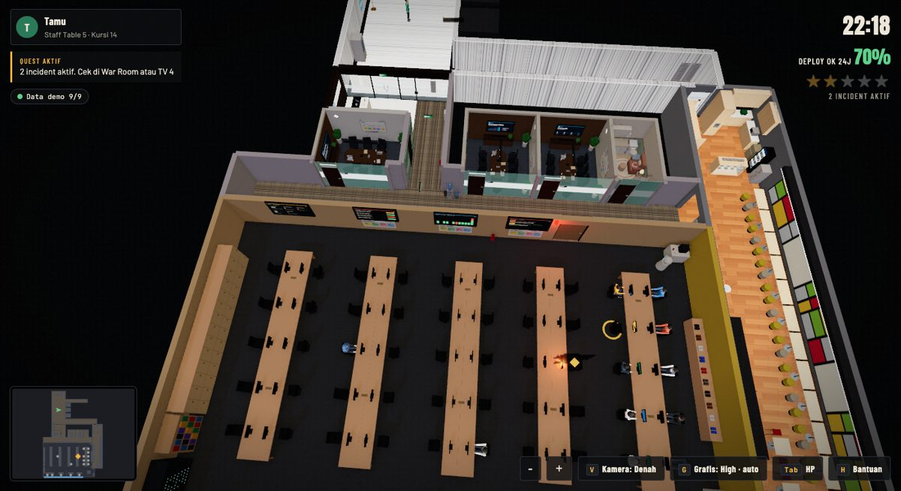
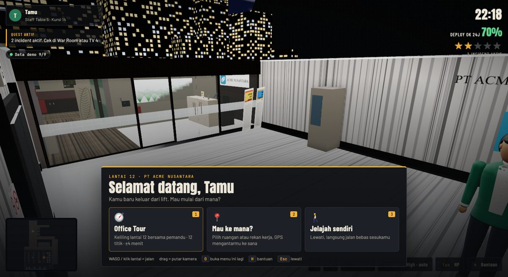
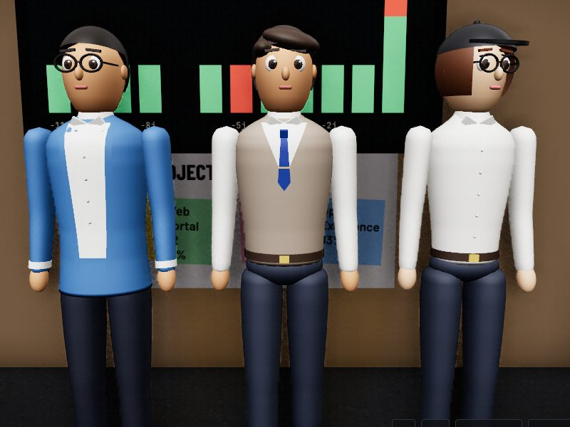
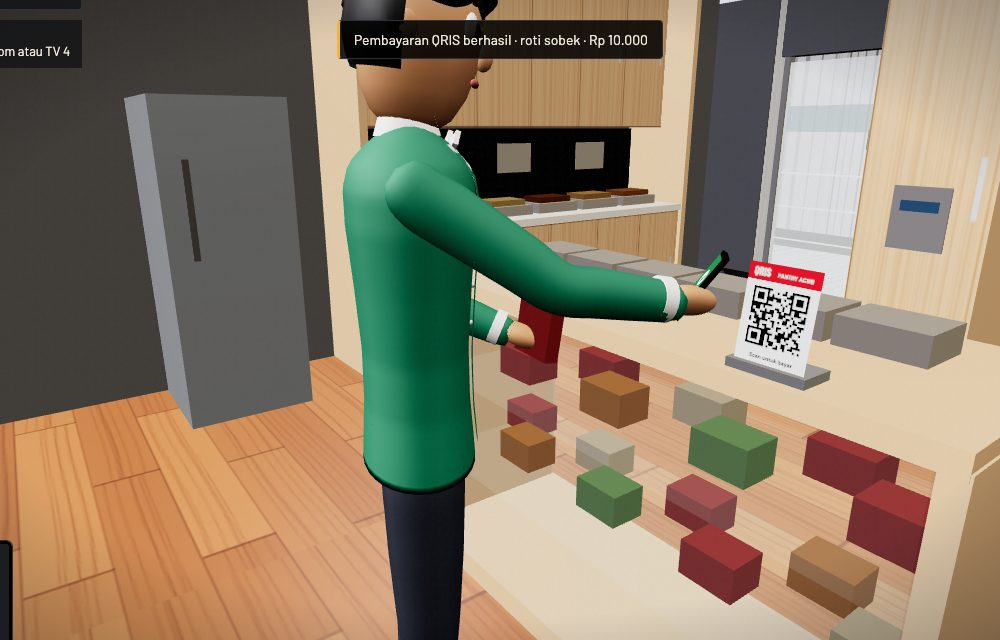

# Virtual Office Mini Player

[](LICENSE)


[](CONTRIBUTING.md)

Kantor virtual 3D yang jalan langsung di browser. Kamu keluar dari lift, jalan ke ruang IT, lalu mengecek dashboard di TV, mereview merge request di meja, memadamkan "api" incident dengan APAR, minum di galon, beli camilan di pantry pakai QRIS, atau JJ bareng rekan kerja. Data proyek (build, merge request, task, incident) tampil sebagai benda di dalam ruangan.



- **Tanpa build step.** Satu `index.html` + dua file konfigurasi. Tidak ada `npm install`.
- **Langsung jalan dengan data dummy.** Tidak butuh server, token, atau akun apa pun.
- **Bisa disambungkan ke data asli** lewat endpoint sendiri sesuai [docs/API.md](docs/API.md).
- **Mudah diganti jadi kantormu:** nama perusahaan, logo, lantai, nilai perusahaan, dan rekan kerja ada di satu file, [`src/config.js`](src/config.js).

> Semua nama orang, perusahaan, project, dan data di repo ini fiktif.

## Daftar isi

- [Fitur](#fitur)
- [Mulai cepat](#mulai-cepat)
- [Cara pakai](#cara-pakai)
- [Pakai dengan AI (vibe coding)](#pakai-dengan-ai-vibe-coding)
- [Kontrol](#kontrol)
- [Menyesuaikan](#menyesuaikan)
- [Mode data](#mode-data)
- [Struktur proyek](#struktur-proyek)
- [FAQ](#faq)
- [Berkontribusi](#berkontribusi)
- [Lisensi](#lisensi)

## Fitur

| | |
|---|---|
|  |  |
| **Office tour & GPS.** Menu sambutan, tur 12 titik, dan pindah cepat ke ruangan atau rekan mana pun. | **Karakter bergaya kartun.** Jas + dasi, rompi, blazer, kemeja, beragam rambut, kacamata, hijab. Badan ber-skin sehingga siku dan lutut melengkung mulus. |



- **Satu lantai kantor lengkap:** lobi lift, resepsionis, lorong, ruang IT dengan 5 meja panjang, ruang meeting 2/3/5, ruang laktasi, dan pantry. Semua ruangan bisa dimasuki.
- **Data jadi benda:** 4 TV (KPI, build, monitoring, incident), whiteboard, tumpukan map approval di meja, dan api untuk incident SEV-1/2.
- **Rekan kerja hidup:** duduk mengetik dengan irama berbeda-beda, menoleh sesekali, dan status di atas kepala dari data.
- **Gerak natural:** langkah dihitung dari jarak tempuh (kaki tidak meluncur), badan condong di tikungan, dan berbalik dengan langkah kecil.
- **Klik untuk jalan ala Dota:** klik kiri atau kanan di lantai, lengkap dengan penanda klik.
- **Aksi beranimasi dengan IK lengan:** ambil gelas lalu isi air dan minum di galon; ambil camilan, keluarkan HP dari saku, lalu scan QRIS di pantry.
- **Quest, HP ala GTA, siang/senja/malam, grafis High/Medium/Low otomatis.**

## Mulai cepat

```bash
git clone https://github.com/anditorx/virtual-office-mini-player.git
cd virtual-office-mini-player
python3 -m http.server 8080
```

Buka http://localhost:8080. Selesai.

## Cara pakai

### 1. Buka langsung dari file

Double-click `index.html`. Browser memuat three.js dan font dari CDN, jadi butuh internet. Semua fitur jalan, kecuali lagu JJ dari folder `assets/` (browser memblokir pemuatan file audio dari `file://`).

### 2. Server lokal

Pilih salah satu:

```bash
python3 -m http.server 8080      # Python 3
npx serve .                      # Node.js
php -S localhost:8080            # PHP
```

Atau pakai ekstensi **Live Server** di VS Code: klik kanan `index.html` → *Open with Live Server*.

### 3. Online gratis (hosting statis)

Isi folder ini sudah siap di-host apa adanya, tanpa perintah build.

- **GitHub Pages:** di repo GitHub-mu buka *Settings → Pages → Build and deployment*, pilih *Deploy from a branch*, branch `main`, folder `/ (root)`, lalu *Save*. Dalam satu-dua menit game ada di `https://<username>.github.io/virtual-office-mini-player/`.
- **Netlify Drop:** buka https://app.netlify.com/drop lalu seret folder proyek ke halaman itu.
- **Vercel / Cloudflare Pages:** import repo, framework preset *Other*, build command dikosongkan, output directory `.` (root).

### 4. Tempel di web app yang sudah ada

Salin seluruh folder (minimal `index.html` dan `src/`) ke folder file statis aplikasimu, misalnya `public/office/` di Next.js, Vite, atau Laravel. Game lalu terbuka di `/office/index.html`.

Untuk menampilkannya di dalam halaman lain:

```html
<iframe src="/office/index.html" title="Virtual Office" allow="fullscreen"
        style="width:100%;height:80vh;border:0;border-radius:12px"></iframe>
```

Klik sekali di dalam iframe supaya keyboard (WASD, E, Tab) masuk ke game.

### 5. Jadikan kantormu sendiri

Ubah [`src/config.js`](src/config.js), simpan, lalu muat ulang browser. Detailnya ada di [Menyesuaikan](#menyesuaikan).

### 6. Sambungkan ke data asli

1. Buat endpoint dengan bentuk JSON sesuai [docs/API.md](docs/API.md). [`src/mock-data.js`](src/mock-data.js) adalah contoh respons lengkapnya.
2. Di `src/config.js`, set `data.mode: 'api'` dan `data.baseUrl` (kosongkan kalau satu origin dengan game).
3. Kalau ingin merge MR, trigger build, dan solve incident dari dalam game, set `data.allowWrites: true`.

Contoh backend minimal (Node.js + Express) yang menyajikan game dan satu route sekaligus, jadi tidak perlu urusan CORS:

```js
// server.js — npm i express, lalu: node server.js
import express from 'express'
const app = express()
app.use(express.static('.'))   // game di http://localhost:8080
app.get('/api/incidents', (req, res) => res.json([
  { id: 'inc-1', incident_number: 'INC-0001', severity: 'SEV-2', title: 'API lambat', status: 'open', service: 'billing-api' },
]))
app.listen(8080)
```

Route yang belum kamu buat hanya ditandai error di **Lemari Perangkat IT** di dalam game; bagian lain tetap jalan.

### 7. Pakai dengan AI

Lihat bagian berikut. Kamu bisa mengubah game ini cukup dengan menulis permintaan ke asisten AI.

## Pakai dengan AI (vibe coding)

Buka folder proyek di asisten AI yang bisa membaca dan mengubah file, misalnya Claude Code, Cursor, Windsurf, atau GitHub Copilot Chat (mode agent). Tempel **prompt pembuka** dulu, lalu salah satu prompt tugas di bawahnya. Ganti teks dalam `[KURUNG SIKU]` dengan milikmu.

**Prompt pembuka** (tempel sekali di awal percakapan):

```text
Kamu bekerja di repo virtual-office-mini-player: kantor virtual 3D berbasis three.js tanpa build step.
Baca README.md, src/config.js, dan docs/API.md dulu sebelum mengubah apa pun.
Aturan proyek:
1. Jangan menambah bundler, framework, atau dependency npm. Game harus tetap bisa dibuka dengan double-click index.html.
2. src/config.js dan src/mock-data.js tetap script biasa (window.VO_CONFIG, window.VO_MOCK), bukan ES module.
3. Bentuk data mengikuti docs/API.md. Kalau menambah route, tambahkan juga contohnya di src/mock-data.js dan dokumentasinya di docs/API.md.
4. Semua nama orang dan perusahaan di repo harus fiktif.
5. Ikuti gaya kode yang ada: komentar singkat berbahasa Indonesia, tanpa titik koma.
6. Benda dekorasi statis ditambahkan langsung ke scene dengan helper cbox/cyl yang sudah ada, supaya ikut digabung pass performa.
7. Setelah mengubah, jalankan python3 -m http.server 8080, buka game, dan pastikan console tidak ada error.
```

<details>
<summary><b>Jalankan dan jelaskan proyek ini</b></summary>

```text
Jalankan game ini di server lokal dan beri tahu URL-nya. Lalu jelaskan singkat dalam bahasa sederhana:
bagian mana di index.html yang membangun ruangan, karakter, data, dan panel, serta file mana yang
sebaiknya saya ubah kalau ingin mengganti nama perusahaan dan rekan kerja.
```
</details>

<details>
<summary><b>Ganti jadi kantor perusahaan saya</b></summary>

```text
Ubah src/config.js supaya kantor ini jadi milik [NAMA PERUSAHAAN]:
- nama di papan resepsionis: [NAMA SINGKAT], nama resmi di dinding lift: [NAMA RESMI], label kecil: [3-5 HURUF]
- warna logo: [KODE WARNA, mis. #e4572e]
- nomor lantai: [ANGKA]
- vision, mission, dan 4 nilai perusahaan: [TULIS NILAI-NILAINYA]
Jangan ubah index.html kecuali benar-benar perlu. Setelah selesai, ambil screenshot lobi lift dan papan resepsionis.
```
</details>

<details>
<summary><b>Ganti rekan kerja dengan tim saya</b></summary>

```text
Ganti daftar npcs di src/config.js dengan tim berikut. Pertahankan kursi (n), id, dan panel yang sudah ada
untuk peran yang mirip; peran baru cukup jadi rekan biasa tanpa panel.
Pilihkan outfit, hairStyle, warna baju, dan glasses yang beragam dan cocok dengan perannya.
Tim saya:
- [Nama] — [Peran]
- [Nama] — [Peran]
- ...
Update juga dancers kalau nama penarinya berubah.
```
</details>

<details>
<summary><b>Pakai logo gambar sendiri</b></summary>

```text
Saya punya logo di assets/logo.png. Ubah drawLogo() di index.html supaya semua papan nama, poster,
layar presentasi, dan kartu QRIS memakai gambar itu. Karena tekstur canvas digambar saat load, muat
gambarnya dulu sebelum scene dibangun, dan pakai logo dummy yang ada sebagai cadangan kalau file
tidak ditemukan. Tambahkan opsi company.logo di src/config.js dan jelaskan di README.
Ingat: assets/ diabaikan git, jadi beri tahu saya kalau logonya perlu di-commit dengan cara lain.
```
</details>

<details>
<summary><b>Sambungkan ke data asli (GitHub, Jira, Jenkins, dll.)</b></summary>

```text
Buatkan backend kecil di folder server/ yang menyediakan route sesuai docs/API.md dengan data asli dari
[GitHub / GitLab / Jira / Jenkins / Asana / sumber lain].
- Bahasa: [Node.js / Python FastAPI]
- Token disimpan di file .env (jangan di-commit, tambahkan ke .gitignore) dan buat .env.example
- Sajikan juga file game dari server yang sama supaya tidak perlu CORS
- Route yang belum didukung sumber saya cukup mengembalikan 404
Lalu set data.mode = 'api' di src/config.js dan tulis cara menjalankannya di README.
```
</details>

<details>
<summary><b>Tambah ruangan atau benda interaktif baru</b></summary>

```text
Tambahkan [NAMA RUANGAN/BENDA, mis. "mesin kopi di pantry"] di [LOKASI].
Saat pemain menekan E di dekatnya: [APA YANG TERJADI, mis. "muncul panel menu kopi dengan 4 pilihan"].
Ikuti pola yang sudah ada: def() untuk objek interaktif, PANELS untuk isi panel, cbox/cyl untuk bentuk,
dan block() supaya tidak bisa ditembus. Tambahkan juga ke daftar Tempat di menu Bantuan (H).
```
</details>

<details>
<summary><b>Tambah aksi beranimasi baru</b></summary>

```text
Tambahkan aksi beranimasi baru: [DESKRIPSI, mis. "di mesin fotokopi, karakter menaruh kertas, menekan
tombol, menunggu, lalu mengambil hasilnya"]. Ikuti pola drinkAct() dan buyAct() di index.html:
keyframe posisi tangan (IK), condong/jongkok, arah kepala, event untuk memunculkan barang dan suara.
Pastikan Esc membatalkan aksi dan barang di tangan disembunyikan saat selesai.
```
</details>

<details>
<summary><b>Online-kan di GitHub Pages</b></summary>

```text
Bantu saya meng-online-kan game ini di GitHub Pages dari branch main (root).
Cek dulu tidak ada path absolut yang rusak kalau situsnya ada di subfolder /virtual-office-mini-player/.
Lalu tulis langkah yang harus saya klik di Settings → Pages, dan tambahkan link demo di bagian atas README.
```
</details>

<details>
<summary><b>Terjemahkan ke bahasa Inggris</b></summary>

```text
Tambahkan dukungan bahasa Inggris. Pindahkan semua teks yang terlihat pemain (HUD, panel, bantuan, tour,
toast) ke satu kamus teks, tambahkan opsi lang: 'id' | 'en' di src/config.js, dan default tetap 'id'.
Jangan ubah nama variabel atau komentar kode.
```
</details>

<details>
<summary><b>Ada error / layar hitam</b></summary>

```text
Game saya [JELASKAN GEJALANYA, mis. "layar hitam setelah loading" / "karakter tidak muncul"].
Jalankan di server lokal, buka console browser, cari error-nya, perbaiki akar masalahnya,
lalu jelaskan apa penyebabnya dalam satu-dua kalimat.
```
</details>

Tips: minta AI **mengambil screenshot** atau menjelaskan cara mengecek hasilnya. Perubahan 3D lebih mudah dinilai dengan mata daripada dengan membaca kode.

## Kontrol

| Tombol | Fungsi |
|---|---|
| WASD / panah | Jalan (Shift = lari) |
| Klik kiri / kanan di lantai | Jalan ke sana (gaya Dota). Klik benda = jalan lalu berinteraksi |
| Drag · scroll · + − | Putar kamera · zoom |
| E · F | Interaksi dengan benda terdekat / terdekat kedua |
| Tab | HP: maps, pesan, quest, Ori |
| Ctrl/⌘ + K | Pindah cepat ke benda mana pun |
| V · G · T · L | Kamera follow/denah · grafis · siang/senja/malam · label |
| O | Menu sambutan (office tour, pilih tujuan) |
| J | JJ bareng rekan (dekati penari dulu) |
| Esc | Tutup panel / batalkan rute atau aksi |
| H | Bantuan lengkap di dalam game |

## Menyesuaikan

Semua yang biasanya ingin diganti ada di [`src/config.js`](src/config.js):

| Kunci | Isi |
|---|---|
| `company` | `name` (papan resepsionis & rambu), `legal` (dinding lift), `short` (poster, TV, HP, QRIS), `color` (logo) |
| `office.floor` | Nomor lantai di dinding lift dan teks sambutan |
| `player` | `name` awal pemain dan `look` (tampilan karakter pemain) |
| `values` | Maksimal 5 poster vision, mission, dan values di lorong |
| `npcs` | Rekan kerja: `name`, `role`, `status`, kursi `n`, panel yang terbuka, dan tampilan |
| `dancers` | Dua nama rekan yang bisa diajak JJ |
| `data` | Mode data, lihat [Mode data](#mode-data) |
| `links.grafana` | Tautan dashboard monitoring (opsional) |
| `audio.jjSong` | Lagu JJ milikmu sendiri, lihat [assets/README.md](assets/README.md) |

**Opsi tampilan karakter** (berlaku untuk `npcs` dan `player.look`):

| Opsi | Nilai |
|---|---|
| `outfit` | `'shirt'` kemeja · `'suit'` jas tertutup · `'blazer'` blazer terbuka · `'vest'` rompi di atas kemeja |
| `hairStyle` | `'short'` · `'side'` · `'slick'` · `'bun'` · `'bob'` · `'cap'` · `'long'` |
| warna | `shirt` (pakaian luar), `inner` (kemeja dalam), `tie` (dasi), `pants`, `hair`, `skin`, `eyes`, `cap` (topi), `belt` |
| lain-lain | `glasses: true`, `hijab: '#warna'` |

Logo dibuat dari kode, bukan file gambar. Untuk memakai logo sendiri, ubah fungsi `drawLogo()` di `index.html`; semua papan nama dan poster memakai fungsi itu.

## Mode data

| `data.mode` | Sumber | Aksi tulis (merge, trigger build, solve incident) |
|---|---|---|
| `'mock'` (default) | [`src/mock-data.js`](src/mock-data.js), di memori browser | Selalu aktif, hanya mengubah data demo. Muat ulang = reset |
| `'api'` | `data.baseUrl` + route di [docs/API.md](docs/API.md) | Mati, kecuali `data.allowWrites: true` |

Data dummy memakai waktu relatif terhadap saat halaman dibuka, jadi grafik build 12 jam, task overdue, dan incident aktif selalu terlihat hidup. Nama tool di dalam game (GitLab, Jenkins, Asana, Grafana, n8n) hanya label untuk jenis data; mode demo tidak menghubungi layanan-layanan itu.

## Struktur proyek

```
index.html            game: scene three.js, karakter, animasi, HUD, panel, quest, tour, aksi
src/config.js         perusahaan, lantai, nilai, rekan kerja, mode data
src/mock-data.js      data dummy + aksi tulis demo (bentuk JSON = docs/API.md)
docs/API.md           kontrak endpoint untuk mode 'api'
docs/screenshots/     gambar untuk README
assets/               file milikmu sendiri (lagu JJ, dll.); sengaja kosong & diabaikan git
.github/              template issue & pull request
```

## FAQ

**Layarnya hitam atau berhenti di loading.**
Pastikan internet tersambung (three.js dimuat dari CDN) dan browser mendukung WebGL. Cek di https://get.webgl.org. Pesan error biasanya muncul di layar loading atau di console browser.

**Berat di laptop saya.**
Tekan G untuk menurunkan grafis ke Medium atau Low. Grafis juga turun otomatis kalau fps rendah.

**Bisa dipakai di HP?**
Bisa dibuka, dengan tap untuk jalan dan drag untuk memutar kamera. Pengalaman terbaik tetap di laptop atau desktop dengan keyboard.

**Apakah data saya dikirim ke mana-mana?**
Tidak. Mode demo tidak memanggil jaringan sama sekali selain memuat three.js dan font. Nama pemain dan lagu JJ pilihanmu hanya disimpan di browsermu sendiri.

**Kenapa tidak ada lagu JJ bawaan?**
Supaya repo bebas file berhak cipta. Beat bawaan dibuat langsung dengan Web Audio; lagu sendiri bisa dipilih dari menu JJ.

## Berkontribusi

Kontribusi sangat diterima: perbaikan bug, ruangan baru, aksi baru, terjemahan, atau dokumentasi.

1. Baca [CONTRIBUTING.md](CONTRIBUTING.md) dan [Code of Conduct](CODE_OF_CONDUCT.md).
2. Buka [issue](../../issues) dulu untuk perubahan besar supaya bisa didiskusikan.
3. Fork, buat branch, kirim pull request dengan screenshot sebelum/sesudah kalau mengubah tampilan.

Menemukan celah keamanan? Jangan buka issue publik; ikuti [SECURITY.md](SECURITY.md). Riwayat perubahan ada di [CHANGELOG.md](CHANGELOG.md).

## Lisensi

[MIT](LICENSE). Bebas dipakai, diubah, dan dijual kembali, asalkan menyertakan teks lisensinya.

Pustaka pihak ketiga dimuat dari CDN dengan lisensinya masing-masing: [three.js](https://github.com/mrdoob/three.js) (MIT) dan font [Anton, Barlow, Barlow Condensed, JetBrains Mono](https://fonts.google.com) (SIL Open Font License).
